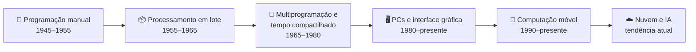

# 🖥️ Aula 02 — Evolução dos Sistemas Operacionais

Como os computadores passaram das válvulas aos dispositivos móveis? Esta aula acompanha a evolução do **hardware** junto às mudanças na forma de executar programas, compartilhar o processador e interagir com as máquinas.

> **Disciplina:** Sistemas Operacionais  
> **Tema:** Gerações dos computadores, processamento em lote e sistemas modernos

---

## 🎯 Objetivos da aula

- 📜 Entender por que cada geração de hardware exigiu novas técnicas de software;
- ⚙️ Diferenciar **processamento em lote**, **multiprogramação**, **spooling** e **tempo compartilhado**;
- 🧭 Localizar os principais sistemas operacionais na linha do tempo;
- 📝 Registrar o estudo em Markdown e ampliar a linha do tempo construída no Miro.

---

## 🗺️ Mapa mental da aula

```text
                          🖥️ Evolução dos SOs
                                    │
      ┌─────────────────────────────┼─────────────────────────────┐
      │                             │                             │
  🔌 Hardware                  ⚙️ Técnicas                    📱 Plataformas
      │                             │                             │
  Válvulas                    Lote (batch)                  Mainframes
  Transistores                Multiprogramação              PCs
  Circuitos integrados        Spooling                      Dispositivos móveis
  Microprocessadores          Tempo compartilhado           Nuvem
```

---

## ⏳ Linha do tempo das gerações

| Geração | Período | Tecnologia base | Como o SO atuava |
|---|---|---|---|
| **1ª** | 1945–1955 | Válvulas eletrônicas | Não existia: programação direta em código de máquina e painéis. |
| **2ª** | 1955–1965 | Transistores | Sistemas em lote (*batch*), com cartões perfurados. |
| **3ª** | 1965–1980 | Circuitos integrados | Multiprogramação, *spooling* e tempo compartilhado. |
| **4ª** | 1980–presente | Microprocessadores | Computadores pessoais, interfaces gráficas e herança do UNIX. |
| **5ª** | 1990–presente | SoCs e redes sem fio | Sistemas móveis com foco em energia, toque e permissões. |
| **6ª** | Futuro | IA contextual e nuvem | Sistemas autônomos, distribuídos e com segurança automatizada. |

---

## 🔄 Como o processamento evoluiu



Cada etapa nasceu de um problema concreto: enquanto a CPU esperava uma operação de entrada/saída, permanecia ociosa. A **multiprogramação** resolveu isso mantendo vários programas na memória e alternando o uso do processador entre eles.

---

## 🧩 Conceitos-chave

| Conceito | O que significa | Problema que resolve |
|---|---|---|
| **Processamento em lote** | Execução sequencial de trabalhos, sem interação do usuário. | Reduzir a intervenção humana entre um programa e outro. |
| **Multiprogramação** | Vários programas na memória, alternando o uso da CPU. | Evitar que a CPU fique ociosa durante a entrada/saída. |
| **Spooling** | Armazenamento intermediário de dados de E/S em disco. | Diminuir a dependência direta das fitas magnéticas. |
| **Tempo compartilhado** | Vários usuários utilizam a máquina por terminais. | Atender múltiplos usuários simultaneamente. |
| **Interface gráfica** | Janelas, ícones e ponteiro do mouse. | Tornar o computador acessível ao público não técnico. |
| **Computação móvel** | Sistemas para dispositivos de mão. | Conciliar bateria, conectividade e segurança. |

---

## 📚 Sistemas que marcaram época

- **MULTICS** — projeto ambicioso de tempo compartilhado que influenciou o UNIX.
- **UNIX** — surgiu como alternativa simplificada ao MULTICS e se tornou base conceitual de **Linux, macOS, iOS e Android**.
- **CP/M** — muito utilizado em microcomputadores na década de 1970.
- **MS-DOS** — dominou os PCs da IBM e abriu caminho para o Windows.
- **Linux** — kernel de código aberto que sustenta servidores, Android e distribuições desktop.
- **Android e iOS** — consolidaram a computação móvel baseada em UNIX.

---

## 📂 Materiais disponíveis

| Arquivo | O que apresenta |
|---|---|
| [📄 historiaSO.md](historiaSO.md) | Guia de estudos organizado por gerações, com linha do tempo, diagramas e mapa mental final. |
| [📝 resumoAula02.md](resumoAula02.md) | Resumo das seis gerações, tabela comparativa, orientações da atividade e referências bibliográficas. |
| [🖼️ linhaTempo2.png](linhaTempo2.png) | Representação visual da linha do tempo. |
| [🖼️ linhaTempo_6geracao.png](linhaTempo_6geracao.png) | Linha do tempo ampliada com as seis gerações. |

---

## 📝 Atividade da aula

O resumo registra duas entregas: um documento Markdown detalhado sobre a evolução dos sistemas operacionais, com base em Tanenbaum e Bos, e a ampliação da linha do tempo do Miro, separada por gerações e publicada no repositório da disciplina.

---

## 📚 Referências

- TANENBAUM, A. S.; BOS, H. *Sistemas Operacionais Modernos*. 4. ed. Pearson, 2016.
- SILBERSCHATZ, A.; GALVIN, P. B.; GAGNE, G. *Fundamentos de Sistemas Operacionais*. 9. ed. LTC, 2015.
- STALLINGS, W. *Sistemas Operacionais: Conceitos e Projetos*. 8. ed. Pearson, 2015.

---

[← Aula 01](../Aula%2001%20%E2%80%94%20Apresenta%C3%A7%C3%A3o%20da%20Disciplina%20e%20Introdu%C3%A7%C3%A3o%20aos%20Sistemas%20Operacionais/README.md) · [📚 Índice da disciplina](../README.md) · [Aula 03 →](../Aula%2003%20%E2%80%94%20Tipos%20de%20Sistemas%20Operacionais%20e%20Git/README.md)
