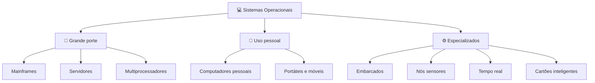
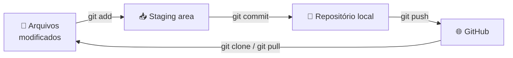

# 🐙 Aula 03 — Tipos de Sistemas Operacionais e Git

Esta aula amplia o conceito de sistema operacional para diferentes plataformas e introduz o **controle de versão** como ferramenta para organizar os estudos e publicar os materiais no GitHub.

> **Disciplina:** Sistemas Operacionais  
> **Tema:** Tipos de sistemas operacionais e configuração da identidade no Git

---

## 🎯 Objetivos da aula

- 🖥️ Reconhecer os tipos de sistemas operacionais e o contexto de uso de cada um;
- ⚡ Relacionar hardware, finalidade e recursos computacionais ao tipo de SO;
- 🐙 Configurar a identidade no Git e compreender o fluxo de versionamento;
- 🌐 Publicar um projeto no GitHub pela IDE ou pelo terminal.

---

## 🗺️ Mapa mental da aula

```text
                          🐙 Aula 03
                               │
      ┌────────────────────────┼────────────────────────┐
      │                        │                        │
  🖥️ Tipos de SO            🐙 Git                📝 Atividades
      │                        │                        │
  Grande porte            Identidade              IDE + GitHub
  Servidores              Add / Commit            Ciclo de clone
  Pessoais                Push / Pull             Open source
  Móveis                  Branches
  Embarcados
  Tempo real
  Cartões inteligentes
```

---

## 🖥️ Classificação dos sistemas operacionais



---

## 📋 Tipos estudados

| Tipo | Foco principal | Exemplos citados |
|---|---|---|
| **Mainframes** | Alta capacidade de E/S, lote e tempo compartilhado. | OS/360, OS/390, Linux em mainframe |
| **Servidores** | Múltiplos usuários em rede, estabilidade e escalabilidade. | Linux, Windows Server |
| **Multiprocessadores** | Várias CPUs/núcleos, escalonamento e sincronização. | Supercomputadores e servidores de alto desempenho |
| **Computadores pessoais** | Uso individual, GUI e compatibilidade de software. | Windows, macOS, Linux |
| **Portáteis e móveis** | Bateria, sensores, permissões e *sandboxing*. | Android, iOS |
| **Embarcados** | Dispositivos dedicados com recursos limitados. | Embedded Linux, QNX, VxWorks |
| **Nós sensores** | Dispositivos minúsculos, orientados a eventos. | TinyOS, Contiki |
| **Tempo real** | Prazos rígidos (*hard*) ou flexíveis (*soft*). | Controle de voo, streaming de vídeo |
| **Cartões inteligentes** | Ambiente restrito, criptografia e autenticação. | Cartões bancários, SIM cards |

---

## 🐙 Git: o fluxo de versionamento

O **Git** é um sistema distribuído de controle de versão criado por *Linus Torvalds*. Ele registra o histórico de edições, permite reverter versões e colaborar por meio de repositórios remotos como o GitHub.



### ⚙️ Comandos essenciais

| Comando | Função |
|---|---|
| `git --version` | Verifica se o Git está instalado. |
| `git config --global user.name "Seu Nome"` | Define o autor dos commits. |
| `git config --global user.email "seu@email.com"` | Define o e-mail vinculado ao histórico. |
| `git add .` | Prepara as alterações para o commit. |
| `git commit -m "mensagem"` | Registra a versão com uma mensagem descritiva. |
| `git push` | Envia os commits locais para o GitHub. |
| `git clone <url>` | Baixa uma cópia do repositório remoto. |

---

## 💡 Boas práticas de versionamento

- 🧩 **Commits pequenos:** histórico granular facilita identificar e corrigir falhas.
- ✍️ **Mensagens claras:** descreva *o que* mudou e *por quê*.
- 🌿 **Branches:** mantenha a `main` estável e desenvolva em branches paralelas.

---

## 📂 Materiais disponíveis

| Arquivo | O que apresenta |
|---|---|
| [📝 resumoAula03.md](resumoAula03.md) | Tipos de sistemas operacionais, fundamentos do Git, boas práticas e atividades propostas. |
| [🐙 manualClone.md](manualClone.md) | Guia prático para clonar repositórios, commitar e enviar alterações, pelo terminal ou pelo VS Code. |

---

## 📝 Atividades propostas

| Nº | Atividade | Objetivo |
|:---:|---|---|
| **1** | Integração IDE + GitHub | Configurar a autenticação no VS Code e validar `commit`, `push` e `pull`. |
| **2** | Ciclo de vida e clone | Criar um projeto, sincronizar, excluir a pasta local e restaurá-la com `git clone`. |
| **3** | Exploração open source | Clonar cinco projetos públicos e analisar a estrutura de arquivos. |

---

## 📚 Referências

- TANENBAUM, A. S.; BOS, H. *Sistemas Operacionais Modernos*. 4. ed. Pearson, 2016.
- SILBERSCHATZ, A.; GALVIN, P. B.; GAGNE, G. *Fundamentos de Sistemas Operacionais*. 9. ed. LTC, 2015.
- STALLINGS, W. *Sistemas Operacionais: Conceitos e Projetos*. 8. ed. Pearson, 2015.
- DENARDIN, G. W.; BARRIQUELLO, C. H. *Sistemas Operacionais de Tempo Real e sua Aplicação em Sistemas Embarcados*. UFRGS, 2014.

---

[← Aula 02](../Aula%2002%20%E2%80%94%20Evolu%C3%A7%C3%A3o%20dos%20Sistemas%20Operacionais/README.md) · [📚 Índice da disciplina](../README.md) · [Aula 04 →](../Aula%2004%20%E2%80%94%20Estrutura%20do%20Sistema%20Operacional%20e%20Instala%C3%A7%C3%A3o%20do%20Windows/README.md)
