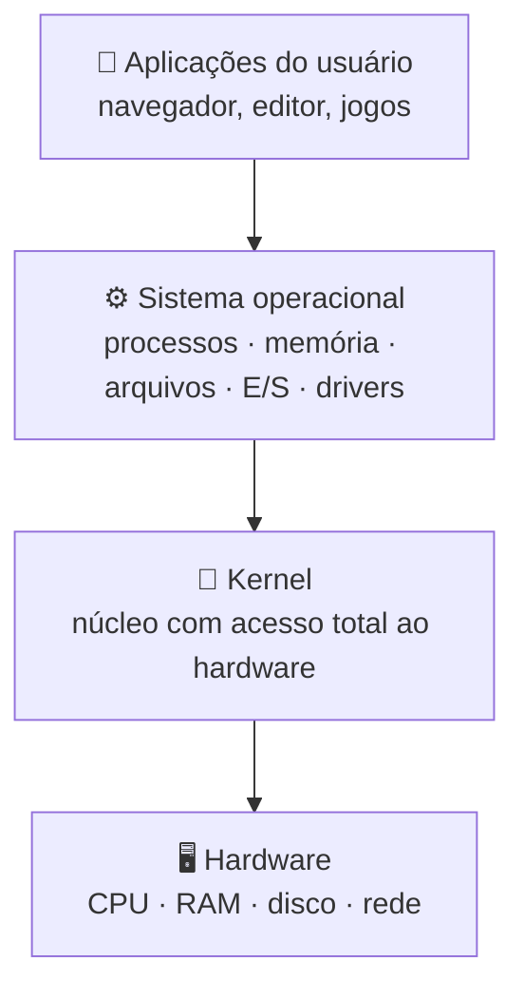
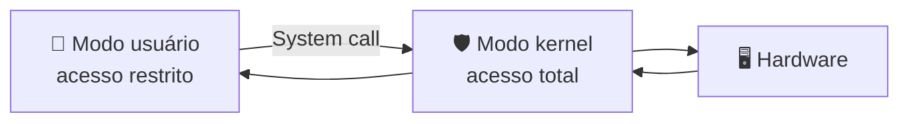

# 🛠️ Aula 04 — Estrutura do Sistema Operacional e Instalação do Windows

Os materiais desta pasta exploram a arquitetura interna do sistema por caminhos complementares: os componentes e modos de execução, o papel do **kernel** e o processo de formatação e instalação do **Windows**.

> **Disciplina:** Sistemas Operacionais  
> **Tema:** Estrutura interna, kernel e instalação do sistema operacional

---

## 🎯 Objetivos da aula

- 🧱 Identificar os componentes de um sistema operacional;
- 🛡️ Entender a separação entre modo usuário e modo kernel;
- ⚡ Diferenciar programa, processo e thread;
- 💿 Relacionar cada etapa da instalação do Windows aos conceitos de SO;
- 🌳 Reconhecer sistemas derivados de bases consolidadas.

---

## 🗺️ Mapa mental da aula

```text
                      🛠️ Estrutura do SO
                               │
      ┌───────────────┬────────┴────────┬───────────────┐
      │               │                 │               │
   🧠 Kernel      🔒 Modos          ⚡ Execução      📂 Recursos
      │               │                 │               │
  Funções         Usuário           Programa         Arquivos
  Drivers         Kernel            Processo          E/S
  HAL             System call       Thread            Drivers
```

---

## 🧱 Arquitetura em camadas



---

## 🧩 Componentes do sistema operacional

| Componente | Responsabilidade |
|---|---|
| 🧠 **Kernel** | Gerencia os recursos críticos e fala diretamente com o hardware. |
| ⚙️ **Processos** | Cria, executa, escalona e finaliza programas. |
| 💾 **Memória** | Aloca, libera e protege a RAM e a memória virtual. |
| 📁 **Sistema de arquivos** | Organiza os dados em diretórios e arquivos. |
| 🔌 **Entrada e saída** | Media a comunicação com os periféricos. |
| 🚗 **Drivers** | Traduzem comandos genéricos para cada dispositivo. |

---

## 🔒 Modos de execução



| 👤 Modo usuário | ⚙️ Modo kernel |
|---|---|
| Executa aplicações comuns. | Executa o kernel e os drivers essenciais. |
| Acesso limitado ao hardware. | Acesso total e irrestrito. |
| Uma falha encerra apenas o processo. | Uma falha crítica gera *blue screen* ou *kernel panic*. |

> **Por que separar?** Para que um programa com defeito ou malicioso não derrube o sistema nem acesse dados de outros programas.

---

## ⚡ Programa × Processo × Thread

| Conceito | Definição | Exemplo |
|---|---|---|
| 📁 **Programa** | Arquivo estático no disco. | `chrome.exe` no SSD. |
| ⚡ **Processo** | Programa carregado na memória e em execução. | Uma instância aberta do Chrome. |
| 🧵 **Thread** | Fluxo de execução dentro de um processo. | Cada aba do navegador. |

```text
Processo: setup.exe (PID 1024)
├── 🖥️ Thread 1 — interface responde a cliques
└── 💾 Thread 2 — lê, descompacta e grava arquivos
```

---

## 💿 Instalação do Windows em quatro fases


Durante o processo, o instalador usa **gerenciamento de memória**, **escalonamento de processos**, **sistema de arquivos** e **drivers de E/S** — os mesmos componentes estudados no restante da aula.

### ⏱️ Linha do tempo da instalação

| Etapa | Conceito envolvido |
|---|---|
| **1. Inicialização** | Hardware e bootloader: a UEFI/BIOS faz o POST e localiza a mídia de boot. |
| **2. Inicialização do instalador** | Gerenciamento de memória e kernel: o Windows PE é carregado na RAM. |
| **3. Reconhecimento de hardware** | Drivers e kernel: identificação de CPU, memória, discos e barramentos. |
| **4. Seleção da unidade** | Gerenciamento de armazenamento (E/S): escolha do disco de destino. |
| **5. Particionamento e formatação** | Sistema de arquivos: criação de partições e da estrutura NTFS com a MFT. |
| **6. Cópia dos arquivos** | Processos, threads e E/S: descompactação do `install.wim` com threads paralelas. |
| **7. Instalação de recursos** | Sistema de arquivos e kernel: registro, `C:\Windows` e rotinas de boot. |
| **8. Configuração de drivers** | Drivers: instalação de suporte a vídeo, rede, som e chipset. |
| **9. Inicialização do sistema** | Kernel e modos de execução: primeiro boot direto do SSD. |
| **10. Windows pronto** | Modo usuário e processos: OOBE, criação de contas e área de trabalho. |

---

## 📂 Materiais disponíveis

| Arquivo | O que apresenta |
|---|---|
| [📝 resumoAula04.md](resumoAula04.md) | Componentes do SO, modos de execução, processos e threads, sistema de arquivos, E/S e reuso de sistemas. |
| [🧠 o-que-e-Kernel.md](o-que-e-Kernel.md) | Explicação didática do kernel, a metáfora do restaurante, suas funções e kernels do mercado. |
| [💿 atividade01-FormatacaoInstalacaoWindows.md](atividade01-FormatacaoInstalacaoWindows.md) | Relatório técnico da formatação e instalação do Windows, com linha do tempo e desafio final. |
| [🔍 atividade02-SistemasDerivados.md](atividade02-SistemasDerivados.md) | Comparação de cinco sistemas derivados: Android, macOS, Ubuntu, webOS e SteamOS. |

---

## 📝 Atividades

### 💿 Atividade 1 — Formatação e instalação do Windows

Percorre pré-boot, Windows PE, particionamento, NTFS e OOBE, relacionando cada fase ao kernel, aos processos, às threads e aos drivers.

### 🌳 Atividade 2 — Sistemas operacionais derivados

Compara cinco sistemas com suas bases e o foco de aplicação:

| Derivado | Base | Foco |
|---|---|---|
| **Android** | Kernel Linux | Dispositivos móveis e embarcados |
| **macOS** | Darwin (Mach/BSD) | Computadores da Apple |
| **Ubuntu** | Debian | Desktops, servidores e nuvem |
| **webOS** | Kernel Linux | Smart TVs e IoT |
| **SteamOS 3.0** | Arch Linux | Consoles e jogos para PC |

---

## 📚 Referências

- TANENBAUM, A. S.; BOS, H. *Sistemas Operacionais Modernos*. 4. ed. Pearson, 2016.
- SILBERSCHATZ, A.; GALVIN, P. B.; GAGNE, G. *Fundamentos de Sistemas Operacionais*. 9. ed. LTC, 2015.
- STALLINGS, W. *Sistemas Operacionais: Conceitos e Projetos*. 8. ed. Pearson, 2015.

---

[← Aula 03](../Aula%2003%20%E2%80%94%20Tipos%20de%20Sistemas%20Operacionais%20e%20Git/README.md) · [📚 Índice da disciplina](../README.md) · [Aula 05 →](../Aula%2005%20%E2%80%94%20Virtualiza%C3%A7%C3%A3o%20e%20Distribui%C3%A7%C3%B5es%20Linux/README.md)
