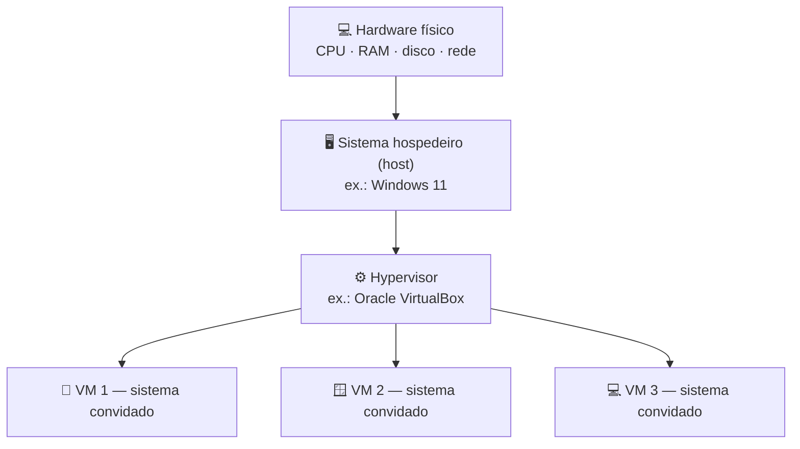

# 🐧 Aula 05 — Virtualização e Distribuições Linux

A aula apresenta a **virtualização** como forma de executar vários sistemas em um único computador e compara distribuições Linux com propostas de uso diferentes.

> **Disciplina:** Sistemas Operacionais  
> **Tema:** Virtualização, Oracle VirtualBox e comparação entre distribuições Linux

---

## 🎯 Objetivos da aula

- ☁️ Entender o conceito de virtualização e seus benefícios;
- 🧱 Identificar os papéis de *host*, hypervisor e *guest*;
- 💻 Instalar o Oracle VirtualBox e criar uma máquina virtual;
- 🐧 Comparar distribuições Linux conforme o perfil de uso.

---

## 🗺️ Mapa mental da aula

```text
                        🐧 Virtualização
                               │
      ┌────────────────┬───────┴────────┬────────────────┐
      │                │                │                │
   ☁️ Conceito      🧱 Arquitetura    💻 Prática      🐧 Distribuições
      │                │                │                │
  Isolamento       Host             VirtualBox       Kali
  Economia         Hypervisor       ISO → VM         Lubuntu
  Testes           Guest            Instalação       Zorin
  Portabilidade    Snapshots        Validação        Ubuntu
                                                      Mint
                                                      Fedora
```

---

## 🧱 Como a virtualização funciona



O **hypervisor** distribui tempo de CPU e memória, emula dispositivos virtuais e garante o **isolamento** entre as máquinas virtuais.

---

## ⚡ Vantagens da virtualização

| Vantagem | Descrição |
|---|---|
| 💸 **Economia de hardware** | Consolida vários servidores em uma única máquina física. |
| 🛡️ **Isolamento seguro** | Testa softwares sem risco para o sistema principal. |
| ⏱️ **Facilidade para testes** | *Snapshots* permitem voltar a um estado anterior. |
| 🐧 **Múltiplos sistemas** | Windows, Linux e macOS no mesmo equipamento. |
| 📦 **Portabilidade** | Configurações empacotadas em arquivos únicos. |

---

## 🔄 Criando uma máquina virtual


O manual da aula registra os mesmos passos com valores de referência: **1024 MB** de RAM para o Tiny Core e **2048 MB** para o Lubuntu, usando a imagem `TinyCore-current.iso` (~23 MB).

---

## 🐧 Distribuições comparadas

| Distribuição | Público-alvo | Ponto forte | Ponto fraco |
|---|---|---|---|
| **Zorin OS** | Iniciantes vindos do Windows/macOS | Interface familiar e versão Lite | Comunidade menor; versão Pro é paga |
| **Kali Linux** | Segurança e *pentest* | Ferramentas de auditoria já incluídas | Pouco amigável para iniciantes |
| **Lubuntu** | PCs antigos ou modestos | Leve e rápido (LXQt) | Interface simples, menos recursos |
| **Ubuntu** | Desenvolvedores e empresas | Comunidade grande e suporte oficial | Mais pesado em máquinas antigas |
| **Linux Mint** | Usuários comuns e iniciantes | Fácil de usar e multimídia pronta | Adota novidades mais devagar |
| **Fedora** | Desenvolvedores e entusiastas | Tecnologias de ponta e apoio da Red Hat | Ciclo curto de suporte |

> **Conclusão da comparação:** não existe “melhor distribuição” em todos os cenários — a escolha depende do objetivo de uso e do hardware disponível.

---

## 🐉 Destaque: Kali Linux

- 🧬 Base **Debian**, lançado em **2013** pela *Offensive Security* como sucessor do BackTrack.
- 🔍 Ferramentas para **reconhecimento** (Nmap, Wireshark), **vulnerabilidades** (OpenVAS, Nikto), **senhas** (John the Ripper, Hydra, Hashcat) e **anonimato** (Tor Browser).
- 💻 Requisitos: 512 MB–1 GB de RAM para uso em CLI e 4–8 GB para interface gráfica.
- 📄 A pasta [apresentKali](apresentKali/README.md) reúne o resumo e o PDF da apresentação.

---

## 📂 Materiais disponíveis

| Arquivo | O que apresenta |
|---|---|
| [📝 resumoAula05.md](resumoAula05.md) | Conceito de virtualização, vantagens, hypervisor, VirtualBox, Tiny Core Linux e passo a passo de criação de uma VM. |
| [📘 atividade01-Manual.md](atividade01-Manual.md) | Manual prático de instalação do VirtualBox e criação de uma VM com distribuição Linux leve. |
| [📊 compSistemas.md](compSistemas.md) | Comparação entre Zorin OS, Kali Linux, Lubuntu, Ubuntu, Linux Mint e Fedora. |
| [🖼️ paginaInicialVirtualBox.jpg](paginaInicialVirtualBox.jpg) | Captura de tela da página inicial do VirtualBox. |
| [🐉 Kali Linux](apresentKali/README.md) | Resumo da distribuição, ferramentas, requisitos e instalação em máquina virtual. |
| [📕 Kali Linux.pdf](apresentKali/Kali%20Linux.pdf) | Apresentação em PDF sobre a distribuição Kali Linux. |

---

## 📝 Atividade da aula

Instalar o Oracle VirtualBox e criar uma máquina virtual com uma distribuição Linux leve (**Tiny Core**, **Lubuntu** ou **Xubuntu**), testar o sistema e documentar todo o processo em um manual Markdown no repositório da disciplina.

---

## 📚 Referências

- TANENBAUM, A. S.; BOS, H. *Sistemas Operacionais Modernos*. 4. ed. Pearson, 2016.
- SILBERSCHATZ, A.; GALVIN, P. B.; GAGNE, G. *Fundamentos de Sistemas Operacionais*. 9. ed. LTC, 2015.
- STALLINGS, W. *Sistemas Operacionais: Conceitos e Projetos*. 8. ed. Pearson, 2015.

---

[← Aula 04](../Aula%2004%20%E2%80%94%20Estrutura%20do%20Sistema%20Operacional%20e%20Instala%C3%A7%C3%A3o%20do%20Windows/README.md) · [📚 Índice da disciplina](../README.md) · [Aula 06 →](../Aula%2006%20%E2%80%94%20Gerenciamento%20de%20Mem%C3%B3ria%20em%20Sistemas%20Operacionais/README.md)