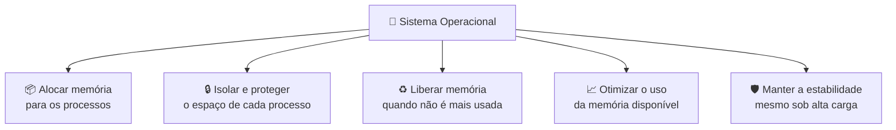
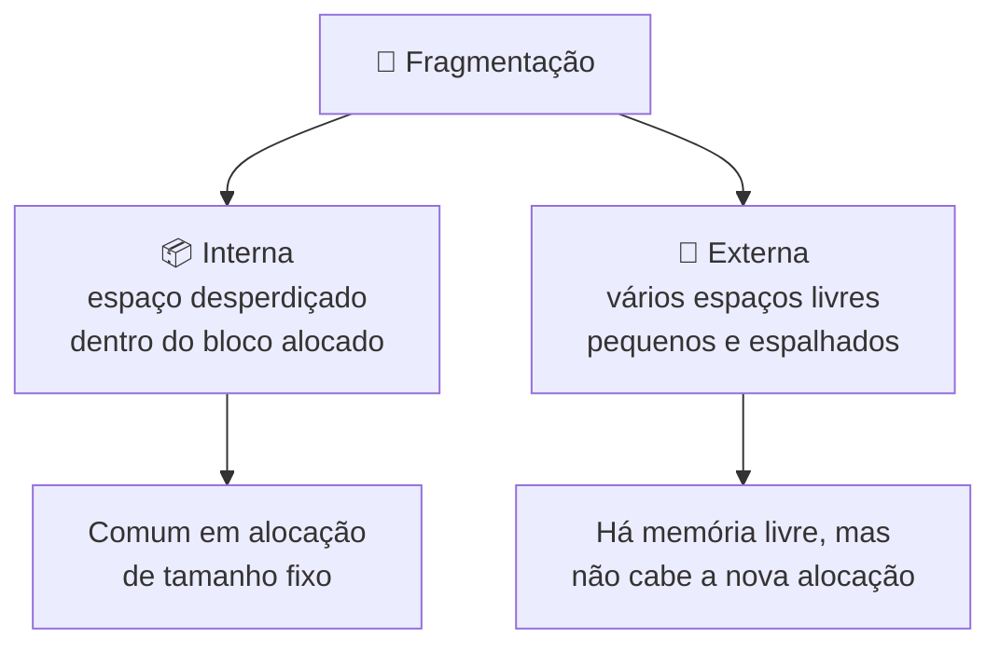
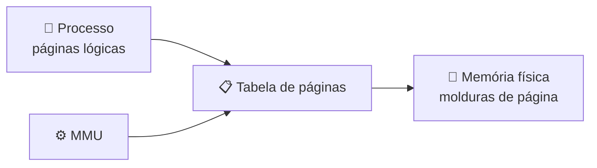
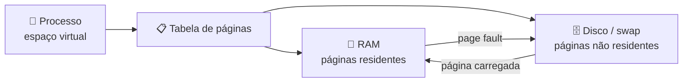
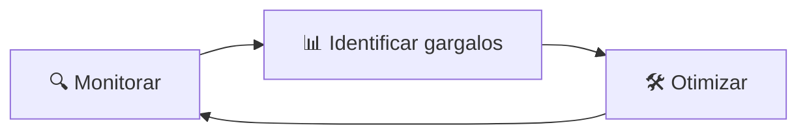
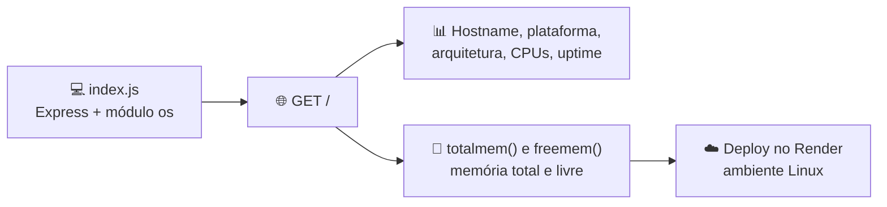

# 🧠 Aula 06 — Gerenciamento de Memória em Sistemas Operacionais

O gerenciamento de memória é uma das responsabilidades mais críticas do sistema operacional: ele decide **quem usa a RAM, por quanto tempo e como**, impactando diretamente o desempenho, a estabilidade, a segurança e a quantidade de processos que podem executar ao mesmo tempo.

> **Disciplina:** Sistemas Operacionais  
> **Tema:** Memória principal, hierarquia, alocação, fragmentação, paginação, segmentação, memória virtual e swapping

---

## 🎯 Objetivos da aula

- 🧠 Explicar a importância da memória no contexto da execução de processos;
- 💾 Identificar os diferentes tipos e níveis de memória;
- 🧩 Compreender os problemas clássicos de alocação e fragmentação;
- 🔧 Comparar as técnicas modernas de gerenciamento de memória;
- 🖥️ Analisar como **Windows** e **Linux** implementam esses mecanismos na prática;
- 💻 Aplicar os conceitos em um projeto real que consulta a memória do servidor.

---

## 🗺️ Mapa mental da aula

```text
                     🧠 Gerenciamento de Memória
                                │
      ┌──────────────┬──────────┴──────────┬───────────────┐
      │              │                     │               │
  💾 Tipos       🧱 Hierarquia         🔧 Técnicas      🖥️ Sistemas reais
      │              │                     │               │
  RAM            Registradores         Paginação        Windows
  Secundária     Cache                 Segmentação      Linux
  Cache          RAM                   Memória virtual  Ferramentas
                 Secundária            Swapping         Monitoramento
```

---

## 🧠 Conceito de gerenciamento de memória

O **gerenciamento de memória** é o conjunto de técnicas e políticas usadas pelo sistema operacional para controlar o uso da **memória principal (RAM)** e sua interação com a memória secundária (disco ou SSD).



Sem um gerenciamento eficiente, o sistema sofre com **conflitos de memória**, **corrupção de dados** e falhas constantes.

---

## 💾 Tipos de memória

| Tipo | Características | Papel |
|---|---|---|
| **Principal (RAM)** | Volátil, acesso rápido, usada diretamente pela CPU | Armazena processos e dados em execução |
| **Secundária** | Não volátil (HD, SSD), maior capacidade e menor custo por GB | Apoia a memória principal |
| **Cache** | Muito rápida, capacidade reduzida, transparente ao programador | Reduz o tempo médio de acesso à memória |

---

## 🧱 Hierarquia de memória

A hierarquia organiza os níveis de memória considerando **velocidade de acesso**, **capacidade** e **custo**. Quanto mais próxima da CPU, mais rápida e mais cara é a memória — e menor é a sua capacidade.


---

## 📦 Alocação de memória

A **alocação** define como o espaço é distribuído entre os processos e deve garantir que cada um utilize **apenas a sua área**, evitando acessos indevidos.

| Aspecto | Alocação estática | Alocação dinâmica |
|---|---|---|
| **Quando é definida** | Antes da execução | Durante a execução |
| **Tamanho** | Fixo | Variável |
| **Flexibilidade** | Pouca | Maior |
| **Exigência sobre o SO** | Baixa | Controle e acompanhamento constantes |

---

## 🧩 Fragmentação de memória

A fragmentação acontece quando a memória não é aproveitada de forma eficiente, reduzindo o espaço útil e afetando o desempenho.



---

## ⚠️ Problemas clássicos e estratégias de solução

| Problemas comuns | Estratégias adotadas |
|---|---|
| Desperdício de memória | **Paginação** |
| Falhas de alocação | **Segmentação** |
| Queda de desempenho | **Memória virtual** |
| Limitação no número de processos ativos | **Swapping** |

---

## 🔧 Técnicas de gerenciamento de memória

### 🧱 Particionamento

A memória é dividida em partições **fixas** ou **variáveis**.

- **Vantagem:** simplicidade de implementação.
- **Desvantagens:** fragmentação interna e externa e pouca flexibilidade.

### 📄 Paginação

A memória é dividida em blocos de tamanho fixo chamados **páginas**, e as tabelas de páginas mapeiam endereços lógicos em físicos.



- Elimina a fragmentação **externa**;
- Pode gerar fragmentação **interna** na última página;
- É a técnica mais utilizada em sistemas modernos.

### 🧱 Segmentação

A memória é dividida em segmentos **lógicos** (código, dados, pilha).

- Facilita **proteção** e **compartilhamento**;
- Reflete melhor a visão lógica do programa;
- Pode gerar fragmentação **externa**.

### 🌌 Memória virtual

Cria a ilusão de que cada processo possui uma grande quantidade de memória disponível.



Benefícios: execução de programas **maiores que a RAM**, melhor aproveitamento da memória e maior **isolamento** entre processos.

### 🔄 Swapping

- Transferência de processos ou páginas entre **RAM e disco**;
- Libera memória para novos processos;
- Se for excessivo, degrada o desempenho (**thrashing**).

---

## 🖥️ Gerenciamento de memória em sistemas reais

Sistemas modernos combinam **paginação**, **memória virtual**, **swapping** e **cache** para equilibrar desempenho, estabilidade e segurança.

| Aspecto | 🪟 Windows | 🐧 Linux |
|---|---|---|
| **Modelo** | Paginação + memória virtual | Paginação + memória virtual |
| **Configuração** | Mais automatizada | Altamente configurável |
| **Controle do usuário** | Menor | Maior |
| **Transparência** | Média | Alta |
| **Arquivo de troca** | `pagefile.sys` | Partição ou arquivo *swap* |
| **Monitoramento** | Gerenciador de Tarefas, Monitor de Recursos | `free`, `top`, `htop`, `vmstat`, `/proc/meminfo` |

---

## 🔧 Ferramentas e análise prática

Ferramentas de monitoramento permitem visualizar o uso de memória, identificar gargalos, detectar consumo excessivo e apoiar decisões de otimização — análises essenciais em produção e em servidores.



---

## 🧪 Casos de uso

- Execução simultânea de múltiplas aplicações;
- Sistemas com recursos limitados;
- Servidores com alta demanda;
- Aplicações que consomem grande volume de memória.

O gerenciamento adequado evita travamentos e melhora a experiência do usuário.

---

## 💻 Projeto prático da aula

Nesta aula foi desenvolvido o repositório **[julianasaunders/SO](https://github.com/julianasaunders/SO)** — um **Monitor de Sistemas Operacionais** em **Node.js + Express** que lê a memória e o ambiente do servidor pelo módulo nativo `os` e exibe tudo no navegador.



| Recurso | Módulo / função | Relação com o conteúdo |
|---|---|---|
| Hostname e plataforma | `os.hostname()`, `os.platform()` | Identificação do sistema operacional |
| Arquitetura e CPUs | `os.arch()`, `os.cpus()` | Recursos de hardware gerenciados pelo SO |
| Memória total e livre | `os.totalmem()`, `os.freemem()` | Aplicação direta do gerenciamento de memória |
| Uptime | `os.uptime()` | Tempo de atividade do sistema |

Repositório: **https://github.com/julianasaunders/SO**

---

## 📝 Atividade da aula

Executar o projeto **[julianasaunders/SO](https://github.com/julianasaunders/SO)** localmente (`node index.js`), observar os valores de memória total e livre, comparar com o ambiente de deploy no **Render** e relacionar as diferenças aos conceitos de alocação, memória virtual e limites do plano contratado.

---

## 📚 Referências

- TANENBAUM, A. S.; BOS, H. *Sistemas Operacionais Modernos*. 4. ed. Pearson, 2016.
- SILBERSCHATZ, A.; GALVIN, P. B.; GAGNE, G. *Fundamentos de Sistemas Operacionais*. 9. ed. LTC, 2015.
- STALLINGS, W. *Sistemas Operacionais: Conceitos e Projetos*. 8. ed. Pearson, 2015.
- [Material-base do professor — Gerenciamento de Memória em Sistemas Operacionais](https://github.com/deivisontakatu/aula-sistemas-operacionais/blob/main/06%20-%20Gerenciamento%20de%20Mem%C3%B3ria%20em%20Sistemas%20Operacionais.md)
- [Projeto Monitor de Sistemas Operacionais](https://github.com/julianasaunders/SO)

---

[← Aula 05](../Aula%2005%20%E2%80%94%20Virtualiza%C3%A7%C3%A3o%20e%20Distribui%C3%A7%C3%B5es%20Linux/README.md) · [📚 Índice da disciplina](../README.md) · [Aula 07 →](../Aula%2007%20%E2%80%94%20Computa%C3%A7%C3%A3o%20em%20Nuvem,%20Containers%20e%20Deploy/README.md)
