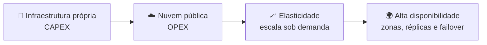
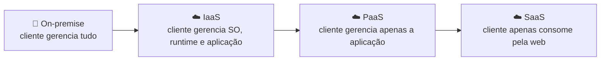
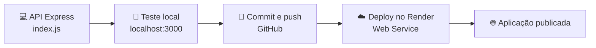

# ☁️ Aula 07 — Computação em Nuvem, Containers e Deploy

Esta aula conecta os conceitos de sistemas operacionais à **computação em nuvem**: modelos de serviço, alta disponibilidade, containers e a publicação de uma API desenvolvida em **Node.js e Express**.

> **Disciplina:** Sistemas Operacionais  
> **Tema:** Nuvem, virtualização, containers e deploy de aplicações

---

## 🎯 Objetivos da aula

- ☁️ Entender os fundamentos da computação em nuvem e o modelo NIST;
- 🏗️ Diferenciar IaaS, PaaS e SaaS;
- 🛡️ Reconhecer os pilares da alta disponibilidade;
- 📦 Comparar máquinas virtuais e containers;
- 🚀 Publicar uma API no Render e comparar execução local × nuvem.

---

## 🗺️ Mapa mental da aula

```text
                        ☁️ Nuvem e SO
                               │
      ┌────────────────┬───────┴────────┬────────────────┐
      │                │                │                │
  ☁️ Fundamentos    🏗️ Modelos       📦 Containers    🚀 Prática
      │                │                │                │
  CAPEX → OPEX     IaaS             Docker          Express
  Elasticidade     PaaS             Kubernetes      GitHub
  Multi-tenant     SaaS             Microsserviços  Render
  Pay-per-use      Nuvem híbrida    Imagens         Local × nuvem
```

---

## ☁️ Da infraestrutura local à nuvem



A migração substitui ativos físicos (**CAPEX**) por serviços contratados sob demanda (**OPEX**), com **autoatendimento**, **amplo acesso à rede**, **pool de recursos**, **elasticidade rápida** e **serviço mensurável** — as cinco características do modelo NIST.

---

## 🏗️ Modelos de serviço



| Modelo | Provedor gerencia | Cliente gerencia | Exemplos |
|---|---|---|---|
| **IaaS** | Hardware, rede, armazenamento e virtualização | SO, middleware, runtime e aplicações | AWS EC2, Azure VMs, Google Compute Engine |
| **PaaS** | Infraestrutura, SO, drivers e runtime | Código-fonte e dados | Google App Engine, Heroku, Render |
| **SaaS** | Toda a infraestrutura e segurança | Apenas o consumo pela web | Microsoft 365, Google Workspace, Slack |

> **Responsabilidade compartilhada:** o provedor garante a segurança **da** nuvem; o cliente garante a segurança **na** nuvem — configurações, acessos e dados.

---

## 🛡️ Alta disponibilidade

| Pilar | Função |
|---|---|
| **Zonas de disponibilidade** | Datacenters isolados com rede e energia redundantes. |
| **Balanceamento de carga** | Distribui o tráfego entre instâncias. |
| **Replicação de dados** | Escrita síncrona entre datacenters. |
| **Failover automático** | Desvia requisições de nós com falha. |

---

## 📦 Máquina virtual × container

| Aspecto | 🖥️ Máquina virtual | 📦 Container |
|---|---|---|
| **Sistema convidado** | SO completo por instância. | Compartilha o kernel do host. |
| **Peso** | Mais pesada. | Leve: empacota aplicação e dependências. |
| **Isolamento** | Total, via hypervisor. | Por processo, via motor de containers. |
| **Ferramentas** | VirtualBox, VMware, KVM. | Docker e Kubernetes. |

Os containers viabilizam a arquitetura de **microsserviços**, com componentes de finalidade única integrados por APIs REST.

---

## 🚀 Do código local ao deploy



### 🔍 Execução local × nuvem

| Informação | Local | Render (PaaS) |
|---|---|---|
| **Plataforma** | `win32` (Windows) | `linux` |
| **Hostname** | Nome da máquina na rede local | Identificador gerado pelo orquestrador |
| **Memória** | RAM física total do computador | Cota do plano (ex.: 512 MB no *Free Tier*) |
| **CPUs** | Núcleos físicos e lógicos | 1 ou 2 vCPUs |
| **Uptime** | Desde o último ligamento | Reinicia a cada deploy ou período de inatividade |

No ambiente local, o processo roda sob o sistema operacional do próprio usuário; no Render, o mesmo código executa em um ambiente Linux gerenciado, com chamadas de sistema mediadas pelo kernel do servidor.

> 💻 A aplicação usada como base é o **[Monitor de Sistemas Operacionais](https://github.com/julianasaunders/SO)**, desenvolvido na Aula 06 para ler memória, CPU e uptime do servidor pelo módulo `os` do Node.js.

---

## 📂 Materiais disponíveis

| Arquivo | O que apresenta |
|---|---|
| [📝 resumoAula07.md](resumoAula07.md) | Fundamentos da nuvem, alta disponibilidade, IaaS/PaaS/SaaS, provedores, containers e referências. |
| [🚀 manual.md](manual.md) | Manual completo da API REST com Express até o deploy no Render, com comparação local × nuvem. |

---

## 📝 Atividade da aula

Criar uma API REST com **Express**, executá-la localmente, publicar o projeto no GitHub e fazer o deploy no **Render**, comparando as informações do ambiente local com as do ambiente em nuvem.

---

## 📚 Referências

- TANENBAUM, A. S.; BOS, H. *Sistemas Operacionais Modernos*. 4. ed. Pearson, 2016.
- SILBERSCHATZ, A.; GALVIN, P. B.; GAGNE, G. *Fundamentos de Sistemas Operacionais*. 9. ed. LTC, 2015.
- STALLINGS, W. *Sistemas Operacionais: Conceitos e Projetos*. 8. ed. Pearson, 2015.
- [Docker — Documentação oficial](https://docs.docker.com/)

---

[← Aula 06](../Aula%2006%20%E2%80%94%20Gerenciamento%20de%20Mem%C3%B3ria%20em%20Sistemas%20Operacionais/README.md) · [📚 Índice da disciplina](../README.md)
